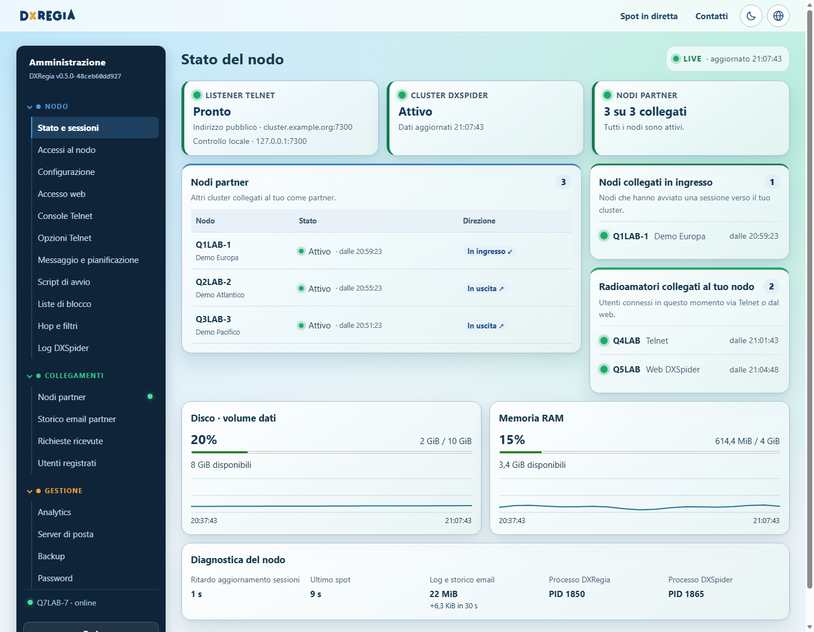

<h1><picture><source media="(prefers-color-scheme: dark)" srcset="dxregia/web/public/brand/dxregia-logo-dark.svg"></picture></h1>

<p><a href="https://github.com/wifi75/dxregia/releases"></a>&thinsp;<a href="https://github.com/wifi75/dxregia/actions/workflows/linux-smoke.yml"></a>&thinsp;<a href="LICENSE"></a>&thinsp;<a href="TASK.md"></a>&thinsp;<a href="https://github.com/wifi75/dxregia/commits/main"></a>&thinsp;<a href="TASK.md"></a><br>
<a href="dxregia/backend/README.md"></a>&thinsp;<a href="dxregia/web/README.md"></a>&thinsp;<a href="https://www.typescriptlang.org/"></a>&thinsp;<a href="https://vite.dev/"></a>&thinsp;<a href="https://github.com/EA3CV/dxspider/tree/mojo"></a>&thinsp;<a href="https://www.perl.org/"></a>&thinsp;<a href="docs/INTERFACES.md"></a><br>
<a href="docs/INSTALLATION.md"></a>&thinsp;<a href="docs/INSTALLATION.md"></a>&thinsp;<a href="dxregia/deploy/README.md"></a>&thinsp;<a href="dxregia/web/src/translations.ts"></a><br>
<a href="https://semver.org/"></a>&thinsp;<a href="CHANGELOG.md"></a></p>

[English](README.md) · [Italiano](README.it.md) · [Español](README.es.md) · **Deutsch** · [Français](README.fr.md) · [Português](README.pt.md)

**Ein DX-Cluster-Knoten für Linux mit Web-Oberfläche, auf Basis von DXSpider Mojo.**

DXRegia macht es einfach, einen DX-Cluster-Knoten zu installieren, zu betreiben und zu teilen. Es behält DXSpider Mojo als Netzwerk-Engine (klassischer Telnet-Zugang, Befehle und Knotenverbindungen) und ergänzt eine moderne Web-Oberfläche und eine öffentliche Seite mit Live-Spots.

## Öffentliches Portal und Verwaltung

Screenshots aus DXRegia mit Beispieldaten. Ein Klick vergrößert das jeweilige Bild.

### Live-Spots · öffentliches Portal

Unter `/spots` verfolgen Funkamateure DX-Spots in Echtzeit, filtern nach Band oder Betriebsart und erkennen DXCC-Gebiete an ihren Flaggen.

[](docs/screenshots/spots.png)

### Knotenstatus und Sitzungen · Sysop-Oberfläche

Unter `/admin` sehen Sysops den Status von Telnet und Cluster, die Richtung der Partnerverbindungen, aktive Sitzungen und Diagramme zur Serverauslastung.

[](docs/screenshots/admin.png)

## Was es kann

- **Live-Spot-Seite** — öffentlich und in Echtzeit. Filter nach Band, Betriebsart und Rufzeichen (auch mehrere zugleich), DXCC-Flaggen, gelbe Hervorhebung und ein sanfter Signalton bei jedem neuen Spot. Läuft auf Smartphone, Tablet und Computer, im hellen oder dunklen Design.
- **Klügere Spots** — die Betriebsart wird aus der Frequenz abgeleitet, wenn der Kommentar sie nicht nennt, und angekündigte DX-Operationen (NG3K ADXO) erscheinen neben dem Rufzeichen.
- **Sechs Sprachen** — Italienisch, Englisch, Spanisch, Deutsch, Französisch und Portugiesisch; jede andere Sprache fällt auf Englisch zurück.
- **Admin-Bereich unter `/admin`** — geführte Ersteinrichtung, Anmeldung mit Passwort und optionaler Zwei-Faktor-Authentifizierung, Live-Dashboard mit Status-LEDs und ein Analytics-Center.
- **Knoteneinstellungen im Panel** — Nachricht des Tages, geplante Befehle, Startskript, Sperrlisten (Wörter, Rufzeichen, IP-Adressen), Hops, Filter und Telnet-Optionen, jeweils mit Tooltip. Das Panel spricht die sechs Sprachen und zeigt, wer sich mit dem Knoten verbunden hat.
- **Registrierung zum Senden von Spots** — Besucher registrieren sich im Portal (Rufzeichen, E-Mail, Passwort) und bestätigen per E-Mail; nur Registrierte können per Telnet Spots senden. Optional, im Panel einzuschalten.
- **Als App installierbar** — das Portal lässt sich auf dem Startbildschirm des Smartphones installieren und öffnet sich auch ohne Verbindung.
- **Partnerknoten** — hinzufügen, verbinden und automatisch wiederverbinden; sehen, wer die Verbindung gestartet hat; einen Knoten löschen, um ihn zu trennen und seinen Zugang zu entziehen.
- **Verbindungsanfragen automatisch** — andere Sysops fragen über deine Kontaktseite an; DXRegia kann ihr Konto anlegen, ihnen deine Verbindungsdaten mailen und bestätigen, sobald sie verbunden sind (Schalter und Tageslimit im Panel). CC-Cluster-Partner können per öffentlicher IP-Adresse oder DNS-Hostname ohne Passwort zugelassen werden. Eine zweite E-Mail bestätigt die aktive eingehende Sitzung.
- **HTML-E-Mails** — Anleitungen und Bestätigungen in sechs Sprachen über deinen eigenen SMTP-Server, im Panel eingerichtet und getestet.
- **Klassischer Zugang bleibt** — Telnet und DXSpider-Befehle für Logger und Benutzer, kompatibel mit bestehenden Knoten.
- **Sicher im Betrieb** — Offline-Backups mit Prüfung, Updates mit einem Befehl und automatischem Rollback, Besucherstatistik ohne Cookies und ohne gespeicherte Adressen.
- **Einfach zu installieren** — ein Skript auf Debian oder Ubuntu (systemd, amd64 oder arm64) oder Docker.

- Speichere und vergleiche Spot-Ansichten, nutze das DXCC-Verzeichnis und den Rufzeichenverlauf und richte Alarme bei geöffnetem Portal ein.
- **Ausbreitung und QSL** — Sonnenindizes und HF-Tag/Nacht- und VHF-Bedingungen von HamQSL, die MUF-Karte von KC2G, aktuelle Spots nach Region und Band sowie WWV/WCY-Berichte. Die Spot-Tabelle hat eine QSL-Spalte für LoTW und eQSL AG. Die Registrierungsseite erklärt die Telnet-Verbindung mit sieben dokumentierten Loggern. Sysops bearbeiten Spot-Regeln unter Hops und Filter.

## Schnellstart

Installiere unter Debian oder Ubuntu mit systemd das vorgefertigte Paket für amd64 oder arm64. Du brauchst curl und sudo oder eine Root-Shell.

```sh
curl -fL -o install-release.sh https://raw.githubusercontent.com/wifi75/dxregia/v0.17.1/dxregia/deploy/install-release.sh
sh install-release.sh v0.17.1
```

1. Öffne die vom Installationsskript angezeigte LAN-Adresse, zum Beispiel `http://SERVER:8080/admin`. Eine neue native Installation lauscht auf allen IPv4-Schnittstellen.
2. Melde dich als `sysop` mit dem angezeigten temporären Passwort an und wähle ein neues Passwort. Zwei-Faktor-Anmeldung ist optional und standardmäßig aus. Unter **Verwaltung → Passwort** aktivieren, Web-Passwort bestätigen, QR-Code scannen und Wiederherstellungscodes sichern.
3. Fülle den Einrichtungsassistenten aus: Rufzeichen des Knotens, Rufzeichen des Sysops, Locator und Telnet-Port. Danach liegt die Spot-Seite unter `/spots` und Telnet antwortet auf Port 7300.

Die Anleitung beschreibt auch Docker und die Installation aus dem Quelltext.

Die Schritt-für-Schritt-Anleitung behandelt Ports, E-Mail, Partnerknoten, Updates, Backups und Fehlersuche: [**Anleitung zu Installation und Konfiguration**](docs/INSTALLATION.de.md).

## Weitere Dokumentation

_Die folgenden technischen Dokumente sind auf Italienisch verfasst._

- [docs/OPERATIONS.md](docs/OPERATIONS.md) — Sysop-Betrieb: Partnerknoten, Logs, Backups
- [docs/INTERFACES.md](docs/INTERFACES.md) — Öffentliche Seite, Admin-Bereich, Telnet und Marke
- [dxregia/deploy/README.md](dxregia/deploy/README.md) — Referenz des Linux-Installers
- [docs/ARCHITECTURE.md](docs/ARCHITECTURE.md) — Architektur
- [TASK.md](TASK.md) — Arbeitsplan
- [CHANGELOG.md](CHANGELOG.md) — Änderungsprotokoll (auf Englisch)
- [Kurzanleitungen und Protokolle (Italienisch)](docs/QUICKSTART.md)
- [Peering-Beispiele in sechs Sprachen](docs/PEERING.md)

**Aufbau des Repositorys:** `dxregia/` enthält den eigenen Code von DXRegia (Backend, Panel, Installer), `engine/` die DXSpider-Mojo-Engine mit ihrer ursprünglichen Struktur und `docs/` die Dokumentation.

## Stand

DXRegia befindet sich in aktiver Entwicklung (Version 0.17.1). Installation, erste Anmeldung, Telnet, Backup und Neustart sind auf Ubuntu 24.04 (amd64 und arm64) getestet. Offen sind noch: ein Test auf Proxmox-LXC, E-Mail-Zustellung bei weiteren Anbietern und ein signiertes Release-Paket. Fehlermeldungen und Ideen sind in den [GitHub Issues](https://github.com/wifi75/dxregia/issues) willkommen.

## Herkunft und Lizenz

DXRegia ist ein unabhängiges Projekt auf Basis von DXSpider Mojo von Dirk Koopman G1TLH und Mitwirkenden (der [EA3CV-Spiegel](https://github.com/EA3CV/dxspider/tree/mojo)). Das Repository enthält die originalen Dateien [COPYING](COPYING) und [LICENSE](LICENSE) (Artistic License 2.0). Angekündigte DX-Operationen stammen von [NG3K ADXO](https://www.ng3k.com/Misc/adxo.html); die Flaggen von [flag-icons](https://github.com/lipis/flag-icons) (MIT).

[Lizenzen und Hinweise zu Drittkomponenten](docs/LICENSING.md)
