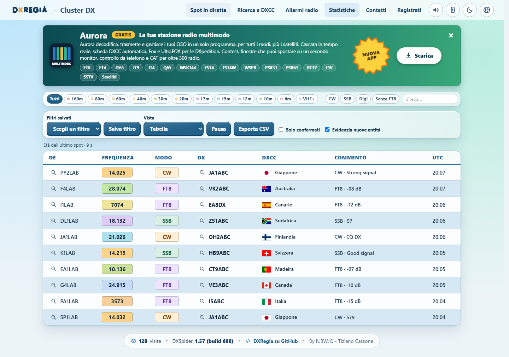

<h1><picture><source media="(prefers-color-scheme: dark)" srcset="dxregia/web/public/brand/dxregia-logo-dark.svg"></picture></h1>

<p><a href="https://github.com/wifi75/dxregia/releases"></a>&thinsp;<a href="https://github.com/wifi75/dxregia/actions/workflows/linux-smoke.yml"></a>&thinsp;<a href="LICENSE"></a>&thinsp;<a href="TASK.md"></a>&thinsp;<a href="https://github.com/wifi75/dxregia/commits/main"></a>&thinsp;<a href="TASK.md"></a><br>
<a href="dxregia/backend/README.md"></a>&thinsp;<a href="dxregia/web/README.md"></a>&thinsp;<a href="https://www.typescriptlang.org/"></a>&thinsp;<a href="https://vite.dev/"></a>&thinsp;<a href="https://github.com/EA3CV/dxspider/tree/mojo"></a>&thinsp;<a href="https://www.perl.org/"></a>&thinsp;<a href="docs/INTERFACES.md"></a><br>
<a href="docs/INSTALLATION.md"></a>&thinsp;<a href="docs/INSTALLATION.md"></a>&thinsp;<a href="dxregia/deploy/README.md"></a>&thinsp;<a href="dxregia/web/src/translations.ts"></a><br>
<a href="https://semver.org/"></a>&thinsp;<a href="CHANGELOG.md"></a></p>

[English](README.md) · [Italiano](README.it.md) · [Español](README.es.md) · [Deutsch](README.de.md) · [Français](README.fr.md) · **Português**

**Um nó DX Cluster para Linux com painel web, baseado no DXSpider Mojo.**

O DXRegia torna simples instalar, gerir e partilhar um nó DX Cluster. Mantém o DXSpider Mojo como motor de rede (acesso Telnet clássico, comandos e ligações entre nós) e acrescenta um painel web moderno e uma página pública com os spots em direto.

## Portal público e administração

Capturas do DXRegia com dados de demonstração. Clique numa imagem para a ampliar.

### Spots em direto · portal público

Em `/spots`, os radioamadores acompanham os spots DX em tempo real, filtram por banda ou modo e identificam as entidades pelas bandeiras DXCC.

[](docs/screenshots/spots.png)

### Estado do nó e sessões · painel do sysop

Em `/admin`, o sysop consulta o estado do Telnet e do cluster, o sentido das ligações, as sessões ativas e os gráficos dos recursos do servidor.

[](docs/screenshots/admin.png)

## O que faz

- **Página de spots em direto** — pública e em tempo real. Filtros por banda, modo e indicativo (vários em simultâneo), bandeiras DXCC, realce amarelo e um breve som por cada spot novo. Funciona em telemóvel, tablet e computador, com tema claro ou escuro.
- **Spots mais inteligentes** — o modo é deduzido da frequência quando o comentário não o indica, e as operações DX anunciadas (NG3K ADXO) aparecem junto ao indicativo.
- **Seis idiomas** — italiano, inglês, espanhol, alemão, francês e português; qualquer outro idioma usa inglês.
- **Painel de administração em `/admin`** — configuração guiada, acesso com palavra-passe e autenticação de dois fatores opcional, painel em direto com LED de estado e centro de análise.
- **Definições do nó no painel** — mensagem do dia, comandos agendados, script de arranque, listas de bloqueio (palavras, indicativos, endereços IP), saltos, filtros e opções de Telnet, cada uma com um tooltip. O painel fala as seis línguas e mostra quem se ligou ao nó.
- **Registo para enviar spots** — os visitantes registam-se no portal (indicativo, email, palavra-passe) e confirmam por email; só os registados podem enviar spots por Telnet. Opcional, ativa-se no painel.
- **Instalável como app** — o portal instala-se no ecrã principal do telemóvel e abre mesmo sem ligação.
- **Nós parceiros** — adicione, ligue e religue automaticamente; veja quem iniciou cada ligação; elimine um nó para o desligar e revogar o acesso.
- **Pedidos de ligação em automático** — outros sysops pedem a partir da sua página de Contacto; o DXRegia pode criar a conta deles, enviar por e-mail os seus dados de ligação e confirmar quando se ligam (interruptor e limite diário no painel). Para parceiros CC Cluster, é possível autorizar a entrada sem palavra-passe por IP público ou nome DNS. O segundo e-mail confirma uma sessão de entrada ativa.
- **E-mails em HTML** — instruções e confirmações em seis idiomas através do seu próprio servidor SMTP, configurado e testado no painel.
- **Acesso clássico mantido** — Telnet e comandos DXSpider para loggers e utilizadores, compatíveis com os nós existentes.
- **Seguro de operar** — cópias de segurança offline com verificação, atualizações com um só comando e reversão automática, estatísticas de visitas sem cookies nem endereços guardados.
- **Fácil de instalar** — um só script em Debian ou Ubuntu (systemd, amd64 ou arm64), ou Docker.

- Guarde e compare vistas, consulte o catálogo DXCC e o histórico por indicativo e configure alertas que funcionam enquanto o portal estiver aberto.
- **Propagação e QSL** — consulte os índices solares e condições HF de dia e noite e VHF do HamQSL, o mapa MUF de KC2G, spots por região e banda e boletins WWV/WCY. A tabela tem uma coluna QSL para LoTW e eQSL AG. A página de registo explica a ligação Telnet em sete loggers documentados. O sysop edita as regras em Saltos e filtros.

## Início rápido

No Debian ou Ubuntu com systemd, instale o pacote pré-compilado para amd64 ou arm64. É preciso curl e sudo ou uma sessão root.

```sh
curl -fL -o install-release.sh https://raw.githubusercontent.com/wifi75/dxregia/v0.17.1/dxregia/deploy/install-release.sh
sh install-release.sh v0.17.1
```

1. Abra o endereço LAN apresentado pelo instalador, por exemplo `http://SERVIDOR:8080/admin`. Uma nova instalação nativa escuta em todas as interfaces IPv4.
2. Entre como `sysop` com a palavra-passe temporária apresentada e escolha uma nova palavra-passe. O 2FA é opcional e vem desativado. Ative-o em **Gestão → Palavra-passe**, confirme a palavra-passe web, digitalize o QR e guarde os códigos de recuperação.
3. Preencha o assistente de primeira configuração: indicativo do nó, indicativo do sysop, locator e porta Telnet. No fim, a página de spots fica em `/spots` e o Telnet responde na porta 7300.

O guia também descreve Docker e a instalação a partir do código-fonte.

O guia passo a passo explica portas, correio, nós parceiros, atualizações, cópias de segurança e resolução de problemas: [**Guia de instalação e configuração**](docs/INSTALLATION.pt.md).

## Mais documentação

_Os documentos técnicos abaixo estão escritos em italiano._

- [docs/OPERATIONS.md](docs/OPERATIONS.md) — Operações do sysop: nós parceiros, registos, cópias
- [docs/INTERFACES.md](docs/INTERFACES.md) — Página pública, painel de administração, Telnet e marca
- [dxregia/deploy/README.md](dxregia/deploy/README.md) — Referência do instalador Linux
- [docs/ARCHITECTURE.md](docs/ARCHITECTURE.md) — Arquitetura
- [TASK.md](TASK.md) — Plano de trabalho
- [CHANGELOG.md](CHANGELOG.md) — Registo de alterações (em inglês)
- [Guias rápidos e protocolos (em italiano)](docs/QUICKSTART.md)
- [Exemplos de peering em seis idiomas](docs/PEERING.md)

**Estrutura do repositório:** `dxregia/` contém o código próprio do DXRegia (backend, painel, instaladores), `engine/` o motor DXSpider Mojo com a sua estrutura original e `docs/` a documentação.

## Estado

O DXRegia está em desenvolvimento ativo (versão 0.17.1). A instalação, o primeiro acesso, o Telnet, a cópia de segurança e o reinício estão testados em Ubuntu 24.04 (amd64 e arm64). Falta ainda: um teste em Proxmox LXC, a entrega de correio com mais fornecedores e um pacote de versão assinado. Relatos e ideias são bem-vindos nas [GitHub Issues](https://github.com/wifi75/dxregia/issues).

## Origem e licença

O DXRegia é um projeto independente baseado no DXSpider Mojo de Dirk Koopman G1TLH e dos seus contribuidores (o [espelho EA3CV](https://github.com/EA3CV/dxspider/tree/mojo)). O repositório mantém os ficheiros originais [COPYING](COPYING) e [LICENSE](LICENSE) (Artistic License 2.0). As operações DX anunciadas vêm do [NG3K ADXO](https://www.ng3k.com/Misc/adxo.html); as bandeiras do [flag-icons](https://github.com/lipis/flag-icons) (MIT).

[Licenças e avisos de terceiros](docs/LICENSING.md)
